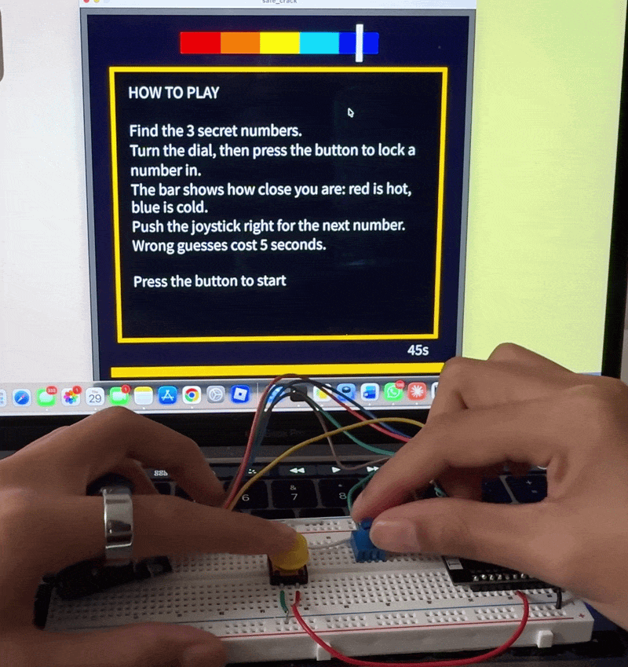
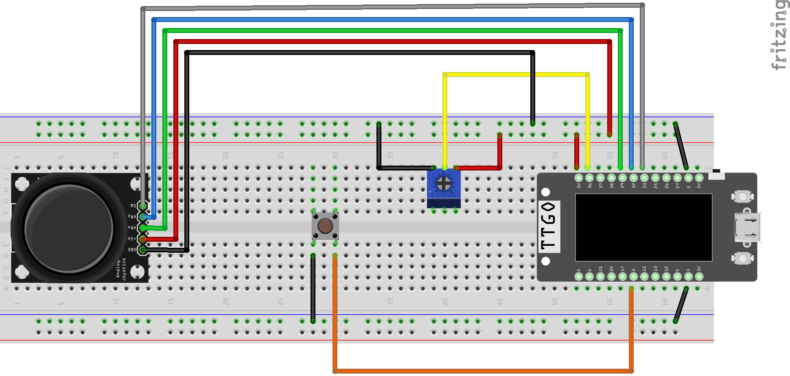

# Dialpick
 
A safe-cracking game played with a physical dial. Find three secret numbers using a hot-to-cold indicator as the clue.

My goal was to make players feel like they're cracking a real safe, with a retro aesthetic. The real dial makes the game feel physical, and the timer keeps the pressure on, so it feels like a heist.

Blog post: [xxxx]
 

The ESP32 reads a potentiometer, a joystick, and a button, and sends the readings to a laptop over serial. A Processing sketch reads them and runs the game.

## What you need
 
- ESP32 LilyGO T-Display
- Potentiometer, joystick module, push button
- Breadboard and jumper wires
- Arduino IDE with ESP32 board support
- Processing
  
## Setup
 
Wire everything to the ESP32 on a breadboard:

- Power: 3V pin to the power rail, and two GND pins to the ground rails (one on each side of the breadboard)
- Potentiometer: outer pins to 3V and GND, middle pin to GPIO 36
- Joystick: GND to GND, VCC to 3V, VRx to GPIO 39, VRy to GPIO 32
- Button: one side to GPIO 2, the other side to GND
 

## Running it
 
1. Upload `code/dialpick-esp32/dialpick-esp32.ino` to the board from the Arduino IDE.
2. Check the Serial Monitor to confirm you're receiving numbers, then close it.
3. Open `code/dialpick-processing/dialpick-processing.pde` in Processing and run it.
4. The sketch prints the available serial ports in the console. In `setup()`, change the number in `Serial.list()[2]` to match your board's port. Make sure both sketches use a baud rate of 115200.

## Playing it
- Turn the dial to find each secret number, press the button to lock it in, and push the joystick right for the next one.
- A white marker on the bar jumps between blue (cold) and red (hot) as you get closer. When you're within 2 numbers of the answer, the bar gets a green outline. That's a five-number zone, but only the exact number counts.
- You have 45 seconds, and a wrong number locked in costs 5s.

##Acknowledgment
- AI acknowledgment: xx
